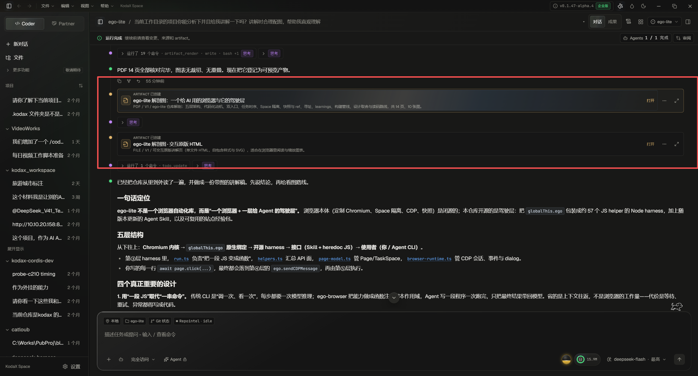

# 为什么侧栏折叠时，打开 artifact 要点击两次？

> 后续实施：本方案已在当前工作分支落地，执行验证见[实施验收](ui-interaction-fixes-validation-2026-11-09.md)。以下保留诊断与讨论当时的范围和证据。

2026-11-09。结论：这是可稳定复现的挂载时序问题。第一次点击的同步事件到达 Shell 并展开侧栏，但负责选中 artifact 的 RightSidebar 此时尚未挂载；事件没有被保留，新侧栏默认停在概览。第二次点击时监听器已经存在，才切换成果并读取目标。应让始终挂载的宿主持有本次打开目标，并在侧栏挂载后交接，同一次点击完成展开与选中。

基线：KodaX Space `ffeb9ed7`。本轮仅诊断与方案，没有修改业务代码；没有点击用户真实会话或读取其实际文件。使用真实 Shell、RightSidebar、ConversationStreamV2、ArtifactsView，以及模拟的 artifact/history IPC 在 Chromium 中隔离复现。

## 1. 用户现象与实际调用链



1. 卡片“打开”执行 `focusInPanel`，同步派发 `kodax-space.focus-artifact`，detail 包含 id 和可用的 snapshot。[ConversationStreamV2.tsx:3248](../../apps/desktop/renderer/src/shell/ConversationStreamV2.tsx#L3248)
2. Shell 在 Coder 分支处理事件时只调用展开侧栏；Partner 分支则直接把 artifact 目标交给自己的详情工作区。本次复现针对 Coder，不能因此声称 Partner 同样失败。[Shell.tsx:1117](../../apps/desktop/renderer/src/shell/Shell.tsx#L1117)
3. Coder 的 RightSidebar 仅在 `rightSidebarVisible` 为 true 时挂载。侧栏关闭时没有目标选中监听器。[Shell.tsx:1709](../../apps/desktop/renderer/src/shell/Shell.tsx#L1709)
4. RightSidebar 初始 tab 是 overview；它在 useEffect 中订阅事件，收到后才设 artifact tab、id 与 snapshot。第一次事件不会向之后新注册的 listener 重放。[RightSidebar.tsx:136](../../apps/desktop/renderer/src/shell/RightSidebar.tsx#L136) · [订阅处理](../../apps/desktop/renderer/src/shell/RightSidebar.tsx#L196)
5. ArtifactsView 已经支持宿主通过 focusedId / focusedSnapshot 交接选择，解决的是“RightSidebar 已挂载、但成果正文尚未挂载”的情况。再向上一层的 Shell 没保留目标，所以这层交接没有覆盖关闭状态。[ArtifactsView.tsx:320](../../apps/desktop/renderer/src/features/artifact/ArtifactsView.tsx#L320) · [Shell 的现有任务聚焦 prop](../../apps/desktop/renderer/src/shell/Shell.tsx#L1717)

## 2. 可运行的反馈循环

临时诊断脚本：[kodax-artifact-open-diagnosis.mjs](C:/Users/ADMIN/AppData/Local/Temp/kodax-artifact-open-diagnosis.mjs)。脚本用当前工作树源码构建实际 Shell，复用主检出的 node_modules 作为依赖；IPC 和预览页面采用模拟数据，未请求模型或实际文件。

```powershell
node C:/Users/ADMIN/AppData/Local/Temp/kodax-artifact-open-diagnosis.mjs
```

已运行多次，结果稳定为 exit 1，断言“折叠侧栏时一次点击应读取选中 artifact”失败。实际信号为：

```text
before: sidebar=false, reads=[]
first:  sidebar=true, artifactTab=false, reads=[]
second: sidebar=true, artifactTab=true, reads=[{id:"anatomy"}]
pageerrors=[]
```

这抓住了用户描述的两阶段行为；失败不是页面崩溃或模拟 IPC 报错。原始记录见[折叠初始态证据](artifact-open-collapsed-evidence-2026-11-09.json)。该脚本为本地临时诊断工具，不是已经合入的永久回归测试。

## 3. 假设与单变量对照

在基线复现后按以下顺序区分假设，均无需改业务源码：

| 假设 | 可证伪预测 | 实际结果 |
| --- | --- | --- |
| 1. 事件到达时目标 listener 尚未挂载 | 仅将初始侧栏设为打开，一次点击就应成功；或在侧栏挂载后重放相同事件，无需第二次用户点击就应成功 | 两个对照均通过，artifactTab=true，读取 id=anatomy |
| 2. 选中状态在挂载后被其它 effect 重置 | 即使 listener 已存在，首次选择仍应失败或迅速回 overview | 初始已展开的一次点击成功，不支持此为主因 |
| 3. 文件内容读取失败或载入慢 | 第一次应已发出 artifact.read，只是正文暂时没有显示 | 第一次没有任何 artifact.read，不支持此为主因 |

已运行命令：

```powershell
node C:/Users/ADMIN/AppData/Local/Temp/kodax-artifact-open-diagnosis.mjs --initial-open
node C:/Users/ADMIN/AppData/Local/Temp/kodax-artifact-open-diagnosis.mjs --replay
```

两者 exit 0，pageerrors 均为空。参见[初始已展开证据](artifact-open-initial-open-evidence-2026-11-09.json)和[挂载后重放证据](artifact-open-replay-evidence-2026-11-09.json)。重放只是用于确认因果关系的探针，不是最终产品方案。

## 4. 最小修复建议

**打开请求由 Shell 持有，侧栏消费已确定的目标。** 在收到请求时同时记录当前会话、项目上下文、artifact id、snapshot，以及区分新请求的标记，再展开侧栏。侧栏新挂载时读取这份目标，切换到正确 tab，并通过已有 focusedId / focusedSnapshot 交给 ArtifactsView。侧栏已展开时同样使用这条路径。[现有 prop 接缝](../../apps/desktop/renderer/src/features/artifact/ArtifactsView.tsx#L320)

已有任务详情聚焦使用 Shell 交接的请求 prop，可以作为本项目风格参照；File Viewer 也已有跨挂载保留打开请求的明确先例。采用一处持有、明确作用域的请求即可，无需引入通用事件队列。[任务聚焦](../../apps/desktop/renderer/src/shell/RightSidebar.tsx#L164) · [File Viewer 请求保留](../../apps/desktop/renderer/src/features/artifact/transientArtifact.ts#L53)

产品行为应是“打开这份成果”：一次操作展示目标内容，内容读取中显示该目标的加载态，失败时保留该目标并就地重试。关闭侧栏、再次打开同一或另一份成果都不能要求用户先恢复面板再选择文件。切换会话/项目时，旧请求不能在新上下文重新生效。

## 5. 修复时应保留的回归场景

- 侧栏关闭 → 点击 PDF / HTML 卡片 → 一次展开、选择正确 id 并开始读取。
- 侧栏已展开在概览 → 点击卡片 → 一次切换至对应成果。
- 侧栏正在看 A → 点击 B → 展示 B；双成果列表不能只验证默认第一项恰好可见。
- 连续请求 A、B，A 的列表/正文迟到 → 最后用户选择 B 保持有效。
- 仅 transcript snapshot 可读、持久列表尚未返回 → 仍定位选中目标，不退到无关默认项。
- 关闭并重新打开、切换会话/项目、窄窗口响应式挂载 → 请求作用域正确，不复活旧选择。
- “独立窗口打开”、保存、文件管理器操作沿各自入口验证；这些路径不应被侧栏选择状态接管。

## 未证实与未解问题

- 未操作用户实际 PDF/HTML；已证明的是所有这些卡片共用的 Coder 打开/挂载链。实际文件预览兼容性属于另一条验证路径。
- 还需在成品 Electron 的过渡动画和响应式布局下走一遍真实入口；隔离 Chromium 证明了时序根因，不能替代平台验收。
- 永久回归测试应覆盖“真实卡片点击 → Shell 条件挂载 → 目标读取”的公共边界，单测 ArtifactsView 已挂载时处理事件会漏掉这次故障。本轮未新增永久测试、未应用修复。
