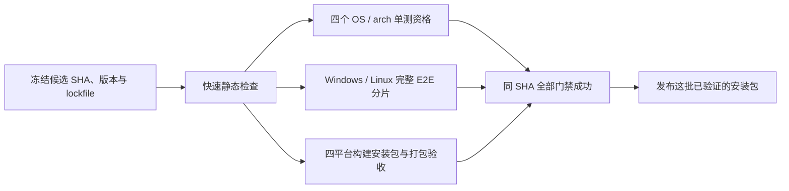

# 如何缩短 KodaX Space 从提交到 CI、release 全绿的时间？

结论：优先消除重复全量单测、解开单测与 E2E 的串行依赖，并将候选包构建与验证并行；其次治理重试和晚发现的失败。当前依赖安装只占几十秒，缓存不是首要瓶颈。下述耗时来自 GitHub Actions API 与日志；收益是按这些记录推演的估算，尚未改造或实测。

## 范围与证据

- 调研日期：2026-10-29；读取最近 60 个 workflow run，详细读取 8 个 run 的 37 条 job 记录（含历史 attempt 返回的记录，不把它们累加为实际用量）。保存了裁剪后的原始时间与步骤：[timing evidence](ci-release-timing-evidence-2026-10-29.json)。API 来源：`GET /repos/KodaX-AI-dev/KodaX-Space/actions/runs?per_page=60` 与各 run 的 `jobs?filter=all&per_page=100`。
- 主要比较对象是最终发布的同一提交 `b2875f64704cf78ca93615f70c25df0c06ec0919`：[CI](https://github.com/KodaX-AI-dev/KodaX-Space/actions/runs/39774700865)、[build](https://github.com/KodaX-AI-dev/KodaX-Space/actions/runs/39774700869)、[release](https://github.com/KodaX-AI-dev/KodaX-Space/actions/runs/39781120109)。同时对照最新 CI 和上一版 alpha.2 release，避免只看失败 run。
- 本地工作区已有大量未提交改动；分析中的运行耗时属于上述历史提交，不代表尚未发布的 SDK alpha.11 等工作区改动。`.github/workflows/`、`scripts/pack.mjs`、`playwright.config.ts` 在本次读取时相对 HEAD 无改动。本调研只新增笔记与时间证据，不运行或修改流水线。

## 实际耗时与关键路径

| 同一发布提交的流程 | 墙钟时间 | 解释 |
| --- | ---: | --- |
| CI | 43分55秒 | Windows shard 1 最慢 |
| build | 20分37秒 | 与 CI 同时开始，不能再加到 CI 时间上 |
| release | 40分23秒 | 先四平台矩阵，再创建 Release |
| 提交触发主干检查到 Release 完成 | 87分46秒 | 包括 CI 结束到 tag workflow 开始的 3分28秒间隔 |

来源：[CI run](https://github.com/KodaX-AI-dev/KodaX-Space/actions/runs/39774700865)、[build run](https://github.com/KodaX-AI-dev/KodaX-Space/actions/runs/39774700869)、[release run](https://github.com/KodaX-AI-dev/KodaX-Space/actions/runs/39781120109)，时间字段见 [evidence](ci-release-timing-evidence-2026-10-29.json)。这是一次成功提交的观测，不是历史平均值，也不包含该提交之前的修复和等待。

| job | 总计 | 单测 | E2E / 打包验收 | 其他重要步骤 |
| --- | ---: | ---: | ---: | --- |
| CI Windows shard 1 | 43分48秒 | 17分28秒 | 22分26秒 | npm ci 37秒 |
| CI Windows shard 2 | 17分16秒 | 无 | 14分33秒 | npm ci 37秒 |
| build Windows | 20分32秒 | 16分47秒 | 无 | 构建 77秒 |
| build macOS arm64 | 17分44秒 | 13分30秒 | 无 | 构建 104秒 |
| release Windows | 37分25秒 | 15分44秒 | 10分50秒 | Build installer 6分56秒 |
| release macOS Intel | 38分33秒 | 19分56秒 | 7分31秒 | Build installer 5分49秒 |
| Create GitHub Release | 1分40秒 | 无 | 无 | 下载 artifacts 29秒 |

来源：上述三个 run 的 job/step 记录，精确 job URL 和原始秒数均在 [evidence](ci-release-timing-evidence-2026-10-29.json)。`Build installer` 包括脚本中的构建、原生模块准备与 smoke，不能全部解释为压缩耗时。调用链见 [pack.mjs](../../scripts/pack.mjs#L98) 和 [package.json](../../package.json#L28)。

最新 CI 同样慢：[39883661430](https://github.com/KodaX-AI-dev/KodaX-Space/actions/runs/39883661430) 用了 42分13秒，Windows shard 1 的单测 19分25秒、E2E 18分57秒。上一版 [alpha.2 release](https://github.com/KodaX-AI-dev/KodaX-Space/actions/runs/38769060483) 也耗时约39分钟，Intel 单测23分24秒；但该版本流程与 alpha.3 不完全相同，不能直接用于前后效果比较。[evidence](ci-release-timing-evidence-2026-10-29.json)

## 为什么慢

1. **同一候选全量 `npm test` 调用9次。** CI Windows/Linux各1次；build 三平台各1次；release 四平台各1次。Windows与Linux各重复3次、macOS arm64重复2次，Intel一次。跨平台验证应保留，但同平台同一提交不必在三个阶段重复。依据：[ci.yml:95](../../.github/workflows/ci.yml#L95)、[build.yml:53](../../.github/workflows/build.yml#L53)、[release.yml:99](../../.github/workflows/release.yml#L99)。这是配置调用次数，不声称各平台跳过项和实际用例数完全相同。
2. **分片1被挂上了整套单测。** Windows两片的E2E本身已不均衡，还把约17分钟单测放在较慢分片之前；分片2早就结束。依据：[ci.yml:82](../../.github/workflows/ci.yml#L82)及 [CI job](https://github.com/KodaX-AI-dev/KodaX-Space/actions/runs/39774700865/job/119810606845)。
3. **“Unit tests”实际包含慢集成测试，桌面测试全局串行。** 根脚本先运行 release脚本测试，桌面脚本使用 `--test-concurrency=1`，日志包含真实Host、daemon、重建和租约生命周期。不能只凭job名称就把所有测试开到高并发。依据：[package.json:49](../../package.json#L49)、[desktop package.json:11](../../apps/desktop/package.json#L11)、[失败的Windows build job](https://github.com/KodaX-AI-dev/KodaX-Space/actions/runs/39760699943/job/119763842602)。
4. **绿灯仍包含 flaky 重试。** 最终发布提交的 Windows CI shard 1 报告4 flaky、71 passed、7 skipped；Windows packaged acceptance报告1 flaky、23 passed。前者涉及权限profiles、Changes展开、Workflow/Memory和history cursor；后者是 complete exit保护其他client。[CI日志](https://github.com/KodaX-AI-dev/KodaX-Space/actions/runs/39774700865/job/119810606845)、[release日志](https://github.com/KodaX-AI-dev/KodaX-Space/actions/runs/39781120109/job/119832328277)。这些数据证明有不稳定性，不能仅凭重跑通过就断言根因都是测试或runner。
5. **失败发现晚，而且重跑单位太大。** [失败release](https://github.com/KodaX-AI-dev/KodaX-Space/actions/runs/39767275771/job/119785753993) 的Windows单测1031秒、构建471秒之后，packaged acceptance仅48秒就因Workflow `run.json` ENOENT失败。[更早一次](https://github.com/KodaX-AI-dev/KodaX-Space/actions/runs/39753897157)也在打包验收阶段失败。源码修复后必须重新验证，但同SHA的验收重试可以避免重新打包。
6. **纯研究文档提交也跑完整CI。** `e3ba5893` 只新增一份 `docs/research/` 笔记，仍触发42分钟CI、20分钟build。[提交](https://github.com/KodaX-AI-dev/KodaX-Space/commit/e3ba5893347e20b09d37f6ea95265daa375bacc3)、[CI](https://github.com/KodaX-AI-dev/KodaX-Space/actions/runs/39883661430)、[build](https://github.com/KodaX-AI-dev/KodaX-Space/actions/runs/39883661424)。不能推广到跳过所有Markdown：内置skills及部分文档参与产品和契约测试。

## 建议的最小改造顺序

### 第一批：先解耦CI，保留验证范围

- 把 Windows/Linux 的全量单测交给独立质量job（可以先沿用现有build矩阵），CI两片只负责构建与E2E。两条检查并行启动，最终门禁同时要求质量检查与E2E成功，不能让E2E `needs` 完整慢单测后再开始。
- 现有macOS build覆盖继续保留。lint目前只在release矩阵里运行，移到早期快速检查，减少发布后才发现静态问题的机会。
- 消除每个job里重复的 `build:packages`：`typecheck`本身会先构建packages，`build:smoke`又会构建。将CI入口的职责理顺，保留本地命令可独立运行的行为。依据：[package.json:21](../../package.json#L21)、[package.json:32](../../package.json#L32)、[package.json:38](../../package.json#L38)。
- 首轮继续保留两片、每个runner `workers:1`，减少变量；随后用每个spec的时间调整分组或试3–4片，先测机器隔离的并行，不直接提高同机Electron worker数。现有隔离原因见 [ci.yml:18](../../.github/workflows/ci.yml#L18) 和 [playwright.config.ts:24](../../playwright.config.ts#L24)。

收益估算：以两个成功CI样本，拆掉串行单测后，CI关键路径可从42–44分钟降至约22–27分钟；这里保留现有E2E耗时和完整三平台质量检查。只是按步骤相减、取并行最大值的模型，实际需要考虑runner速度、排队和native rebuild变化。第一批不改release时，提交到发布预计仍约65分钟左右，不能宣称已降到半小时。

### 第二批：一次候选验证，一次打包，最终统一放行

推荐对明确的发布候选采用如下依赖关系：

- 将重复9次的完整测试合并成每个OS/arch一次。**Intel不能直接删掉**：现有普通build矩阵不覆盖它。发布候选的资格矩阵须补齐Intel，然后release消费其同一SHA结果。普通PR是否也跑Intel可另定，但正式候选必须覆盖当前四平台。
- 打包、源代码E2E、慢单测同时推进，创建公开Release等待全部门禁。可先复用workflow/job，再决定是否合并文件；不需要引入发布服务或新的调度框架。
- 当前release创建job只有 `needs: build`，这里的build仅指release内部矩阵，**YAML没有验证外部ci/build是否同SHA全绿**。移除release重复检查前必须把这个条件机器化。最简单是同一候选workflow统一 `needs`；跨workflow则验证来源仓库、允许的workflow、精确head SHA、结论及artifact出处，任何缺失都不得放行。[release.yml:197](../../.github/workflows/release.yml#L197)
- tag应指向已经验证的候选；不能拿main上另一个SHA、旧SDK或旧安装包的绿灯替代。候选如果修改版本、源码或lockfile，重新产生资格证据与产物。
- 后续可将打包与packaged acceptance拆成job，先保存可运行的unpacked app，再在同OS/arch下载验收，失败时只重跑验收。macOS执行权限与symlink需要归档保留。现有installer artifact不包含这些unpacked目录，不能直接拿现有artifact实现。[release.yml:183](../../.github/workflows/release.yml#L183)；平台细节见 [参考笔记](ci-release-platform-options-2026-10-29.md)。只有传输成本低于省下的重跑成本时再拆，不必一次改完。

收益估算：如果仍“源代码资格全部通过后才开始打包”，拆掉重复测试后候选到发布大致45–55分钟；如果图中的三条慢路径并行，按现有单测最长约20分钟、E2E最长约22分钟、去重复测试后的打包验收约20分钟，**25–35分钟是值得验证的目标**。这两个区间是不同排程方案，不能把各项收益相加；需有足够并发runner，也不包含发布前本地测试、人工审核与失败后的修复时间。

### 第三批：降低失败成本与无效运行

- 记录首次通过率、flake数量、最慢spec、每个平台p50/p95；成功但发生重试时也上传报告/trace。目前workflow的失败附件使用 `if: failure()`，重试后成功不会走该上传步骤。[ci.yml:129](../../.github/workflows/ci.yml#L129)、[release.yml:172](../../.github/workflows/release.yml#L172)
- 优先排查上面已经出现的Host完成与文件落盘时序、进程退出和跨client状态问题。等待明确的持久化/退出信号，减少固定sleep及为所有测试继续加长timeout；维持断言语义，不靠跳过关键测试制造绿灯。
- 普通PR/branch checks按workflow+PR/ref取消过时run；候选发布以版本/SHA隔离，不把正在发布的版本被新main提交取消。并发机制的官方依据见 [参考笔记](ci-release-platform-options-2026-10-29.md)。
- 从明确非产品输入的 `docs/research/**` 开始做changes分类，保留始终出现的汇总gate；不要先一刀切跳过 `**/*.md` 或所有docs。required check与路径过滤的陷阱见 [参考笔记](ci-release-platform-options-2026-10-29.md)。
- 精准重跑失败job，记录失败证据；改了SHA时重新验证，不把旧artifact或旧绿灯拼到新版本。跨job拆分是为了降低同一SHA的重试成本，不是让确定性失败自动消失。

## 低收益项及暂不推荐

- 可以加Electron/electron-builder下载缓存，但样本npm ci约23–95秒，先优化它只能节省小部分墙钟时间。不要把npm下载缓存误认为已经缓存node_modules；不要跨Node/Electron ABI复用better-sqlite3产物。现有脚本刻意区分runtime并默认源码编译：[ensure-sqlite-native.mjs](../../scripts/ensure-sqlite-native.mjs#L102)。
- `pack.mjs`已运行 `smoke-pack`，release又执行一次，删除重复调用可省约几十秒，但保留至少一次且绑定当前包。[pack.mjs:98](../../scripts/pack.mjs#L98)、[release.yml:146](../../.github/workflows/release.yml#L146)
- 生成Release本身只用了约100秒，不优先为其安装tooling写复杂优化。[release job](https://github.com/KodaX-AI-dev/KodaX-Space/actions/runs/39781120109/job/119851478335)
- 不直接删除macOS/Linux验证、不默认把完整E2E移到夜间、不盲目开全局高并发、不放宽未校验native预构建策略。可先拆纯逻辑测试与有共享资源的集成测试，纯逻辑再试有限并发；其余保持隔离。
- 不先降低压缩等级：AppImage配置明确要满足200MiB体积门槛，Windows ZIP也有下载回退用途；除非测得压缩是剩余瓶颈并验证包体积与分发要求。[electron-builder.yml](../../electron-builder.yml#L294)

## 未证实

- 尚无足够时间序列计算长期p50/p95；最近60条包含诊断分支和手工run，不能直接混算成功率。
- 尚未测量纯逻辑/集成测试各占多少时间，以及3–4 E2E分片、有限单测并发的实际收益。
- 尚未验证账户并发额度、runner排队、branch protection required checks、artifact保留策略和unpacked包跨job传输成本。
- 本笔记中的22–27分钟、45–55分钟及25–35分钟是不同改造阶段的模型估算，不是已经实现的性能结果。

## 未解问题与验收方式

- 发布是否允许“先构建候选、全绿后公开发布”？技术上可保留全部门禁，代价是在其他检查失败时仍可能消耗构建算力。
- 建议先落第一批，以同一候选、相同测试集合做前后对照；统计首次通过率与关键路径，确认没有因拆job漏测。
- 第二批验收须覆盖失败情况：任意unit/E2E/packaged acceptance失败、证据缺失或SHA不符时，均不得发布。统计测试集合与产物哈希，确认发布的是已验证字节；再观察数次真实发布评估稳定性。
- 本次完成的是方案调研，工作流尚未修改；平台机制的官方引用另见 [ci-release-platform-options-2026-10-29.md](ci-release-platform-options-2026-10-29.md)。
