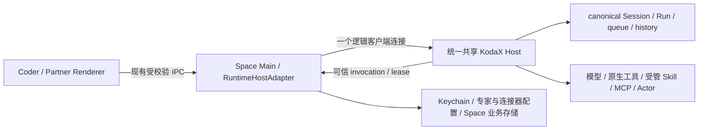

# Space 如何完整适配 KodaX 统一 Host SDK

结论摘要：需要一次覆盖 Coder、Partner、可信 Main 授权、会话写入、恢复、退出和安装交付的迁移，不能只升级依赖或删除设置选项。建议保留现有 Space IPC/RuntimeHostAdapter，统一成一个 SDK 连接和一个实际 Session 写入者；先补齐并发布可核验的上游契约，再切换全部产品执行路径。已提交的统一 Host 基线仍拒绝 Partner，后续工作区也存在准入广告、默认 Skill、排队角色与恢复契约缺口，现阶段不能宣告 Space 可直接无回归升级。依据见 §1–§3。

日期：2026-10-31（Asia/Shanghai）。状态：**调研与建议方案，尚未转为接受设计或实施票；本文不宣告 Space 已迁移或 SDK 已发布。**

## 1. 本轮冻结了哪些事实

| 标签 | 本轮实际来源 | 使用边界 |
| --- | --- | --- |
| S | `C:/Works/GitProj/KodaX-AI/KodaX-Space`，HEAD `7801a8ca099c4ecf47af5b1e361ff6812f8c12b9` | 当前 Space 源码；原有 `tests/fixtures/file-preview/fixture.txt` 修改保持原样。 |
| I | Space 实际安装的实体 `node_modules/@kodax-ai/kodax`，`0.7.97-alpha.11` | 不是开发链接；root、Desktop、npm lock 与安装版本一致。 |
| U | KodaX 已提交 `f6a010462a477bd1b36dd849a6c9c0dbb0f76808` | 本轮统一 Host 的接受基线；读取 Git 对象，不把同名版本号当新发行包。 |
| W | KodaX 主仓库在 U 之后的未提交工作区 | 包含 Partner/profile/effectiveConfig/恢复与其他并行修复；只作待发布候选证据，不能视为已验收发行契约。关键 blob 见上游笔记 §1。 |

引用采用 `来源:文件:行`。Space 的无目录业务文件名与 `runtime/` 简写位于 `apps/desktop/electron/kodax/`；`main.ts` 位于 `apps/desktop/electron/`，`ipc/`、`settings/`、`memory/`、`skill/`、`partner-connectors/` 也以 Electron 目录为根；`renderer/` 位于 `apps/desktop/`，`channels/` 位于 `packages/space-ipc-schema/src/`。其余带完整路径的引用以对应仓库为根。专项笔记附更完整的逐文件引用与版本边界。

2026-10-31 实际查询第一方 Registry `npm view @kodax-ai/kodax dist-tags --json`，返回 `latest=0.7.96`、`alpha=0.7.97-alpha.11`、`hotfix=0.7.72-hotfix.0`。查询证明当时 dist-tag，未核验所有无 tag 版本。I 的 lock integrity 为 `sha512-Fo4qL6qvA/1ViL8sElvXB+X0+xP6c23GGJ5iJY10wDUDLXokIiVXY8+4bXx3r8OYFyiqUyBJ7+9v2UnCc5cNHg==`。U/W 的本地 manifest 仍写 alpha.11，不能据此替换 Registry 字节或认定 Space 已获得新接口。来源：Registry 查询；S:`package.json:59`、`apps/desktop/package.json:16`、`package-lock.json:2153`；U:`docs/SDK_MIGRATION.md:3`。

三份专项笔记提供逐项一手源码引用和探针边界：

- [上游 SDK 契约、安装事实与声明探针](unified-host-sdk-upstream-contract-2026-10-31.md)。
- [Host 生命周期、退出、安装与交付](unified-host-space-lifecycle-delivery-2026-10-31.md)。
- [Partner 与各业务域的逐项迁移映射](unified-host-space-partner-integrations-2026-10-31.md)。

## 2. 建议的最终职责边界

建议保留 Code/Partner 的工作面、身份和权限隔离；将它们从“两个执行 owner”改成“同一 Host 中的两个业务范围”。Main 保留窗口、可信授权、账号、专家配置、Source/KB、Office/Artifact 产品存储以及平台交互。Host 拥有真实 Session、Run、队列、原始输出和执行事实。当前 router 仍把 owner 写为 `coder-daemon | partner-inline`，Adapter 又在 create/ensure/list 三处拒绝 Partner，因此必须改完整调用链。依据：S:`apps/desktop/electron/kodax/runtime/surface-runtime-router.ts:9,42,80`、`runtime-host-adapter.ts:3557,3578,3603,3666`。

“只有一个执行 Host”不要求删除独立 `/agent`、`/coding`、`/llm` 库或本地产品存储；要求 Space 不再用这些库创建第二个产品 Session 写入者。当前 Partner 确实调用 `sdk.runManagedTask` 并取得默认 Session storage，即使 Runtime SDK 不再导出 embedded 构造，这条直接写入路径仍需由 Space 主动迁走。依据：S:`apps/desktop/electron/kodax/real-session.ts:2435,2645,2671`、`session-store.ts:127,139`；U:`src/sdk-coding.ts`、`src/sdk-runtime-public.ts:1`。

## 3. 先处理的阻塞，及责任归属

| 项目 | 已证实事实 | 建议处理与放行条件 |
| --- | --- | --- |
| B1：公开 API 已变化 | Space import/type/call 依赖 `RuntimeInlineOwnerHandle`、acquire/enable owner；U 已删除公开导出。声明探针已证明不兼容。S:`runtime-host-adapter.ts:1,1791,2772,7904`；U:`src/sdk-runtime-public.ts:1`。 | Space 删除这些执行控制依赖；只保留必要的 owner 状态诊断。类型通过和真实首次启动都必须验收。 |
| B2：Partner 准入与广告不一致 | U 仍明确拒绝 Partner；W 允许创建 Partner，但 server 仍广告 `sessionAdmission.surfaces=CODER列表 / partnerDenied:true`；`productExecutionProfile:v2` 不会覆盖它。U:`src/sdk-runtime.ts:21392`；W:`src/sdk-runtime.ts:21444`、`src/runtime-daemon/server.ts:152,2677,2796`。 | 上游先冻结并修正握手、create/read/list/observe/execute/recover 的一致契约，用实际发行候选 Host 验收。Space 不忽略 `partnerDenied` 强行执行，也不恢复 inline。 |
| B3：默认 Skill / 准备策略 | 原 Partner 有精确专家默认 Skill、显式 slash 覆盖、禁止 context fork 和完全禁用动态 shell。纯 profile 只复制 persona/verification/tools/metadata；产品 submit 没有默认方法 Skill 字段。S:`real-session.ts:610,724,1051,2562`；W:`src/execution-profile.ts:9`、`packages/coding/src/client-contract.ts:785`。 | 优先复用 Host Skill lifecycle，补足可信默认方法选择与原 Partner 准备限制的窄接缝；保留原始用户输入、hooks/finalize/model override/allowedTools。不能靠 prompt 拼名、只读 shell 或低层 options 旁路宣称等价。 |
| B4：排队角色和原授权恢复 | Partner 下一轮使用 dequeue 时最新已 ACK 专家；新 Host 在 accept 时捕获 profile，修改同 inputId 的 profile 会冲突。Space store 不接 profile，跨 runtimeId 又不能直接取到原记录。S:`partner-expert-runtime.test.ts:604`、`runtime/runtime-input-authorization-store.ts:9,46`；W:`src/session-input-queue.ts:28,134,248`。 | 默认保留旧角色时点：上游补派发前可信角色/方法绑定并持久化，安全上限不得隐式扩大。同步补跨 Host 原授权证明。若改成接收时冻结角色，必须明确作为产品语义变更接受，不能视为无回归迁移。 |
| B5：普通退出与安装证据混用 | `host=protected + cleanup=succeeded` 在普通退出投影为 clean；纯组合探针复现其进一步置 `daemonStopConfirmedBeforeQuit=true` 并通过 installer 条件。S:`runtime/runtime-client-exit.ts:77`、`runtime-host-adapter.ts:7842`、`main.ts:1880,2890`。 | Space 单独保存“自身退出完成”和“精确 Host 已退出”两项事实；安装只消费严格后者。加入预检后 peer 加入的回归。 |
| B6：安装期重新启动与多根窗口 | U startup gate 只覆盖 ensure；旧 Host 退出后 peer 可理论上重新 ensure。Space profile override还会改变userData/单实例锁，同一安装可有多个配置/Session根和Main/Host。单根退出不证明同安装无使用者。U:`src/sdk-runtime.ts:5897`、`src/runtime-daemon/client-lifecycle.ts:69`；S:`data-paths.ts:106`、`main.ts:273,2079`。 | 上下游明确以实际安装origin为范围、覆盖各数据根及文件替换期的维护边界；可复用SDK已有协调，但不能只锁当前Session根。协议未具备时保留阻断自动安装，或采用已验收的版本隔离payload；不私持内部lock或全局按进程名kill。 |

B2/B3/B4 是上游契约前置；B5 可先独立修复 Space。B6 需要上下游共同确定可测试的交付约束，不能以“再检查一次 PID”替代原子保证。当前研究没有运行真实 installer；它也不是发布新通用配置/插件框架的理由。

## 4. 连接方案：默认保留现有单一 Runtime 连接

Space 目前是 `ensureKodaXRuntime / connectKodaXRuntime` 加可信 Main 手动产品授权，不是 `ensureKodaXClient`。本轮建议沿用该单连接和 RuntimeHostAdapter，扩大其业务 surface 支持。`/runtime` 的连接与可信桥仍是 U 的公开能力；不需要为了消除 embedded 而重写整套 Renderer/IPC。依据：S:`runtime-host-adapter.ts:1713,6234,6484,6588`；U:`src/sdk-runtime-public.ts:24`。

W 已公开纯 `createExecutionProfile(context, catalog)`；可用同一 Runtime 的 `catalog.executionTools(sessionId)` 加本次已授权 HostTool descriptors 构建 profile。必须先验证 `productExecutionProfile.version===2`，拒绝工具同名碰撞，按 SDK 的实际 metadata 映射生成快照，保存 persona、verification、tool names 与 metadata。上下文中的 `promptOverlay/skillsPrompt/skillInvocation` 不会被 builder 自动复制。依据：W:`src/sdk-client.ts:16`、`src/execution-profile.ts:4,9`、`src/client-runtime-adapter.ts:20`；S:`real-session.ts:2562`。

不采用“另开一条同身份 /client”来补服务：公开 SDK 没有 `toProductClient(existingRuntime)`；同 stable principal/secret 的新 transport 会替换前连接并断开它。改用另一个身份又会改变 peer、lease 和退出统计，不能作为透明实现。若未来改成唯一 Product Client，需先补足当前真正需要的底层服务；不通过 deep import 内部适配器绕过 public exports。依据：U:`src/sdk-client.ts:50`、`src/runtime-daemon/reverse-bridge.ts:855`、`src/runtime-daemon/server.ts:785`。本方案选择单 Runtime 适配，因此这项技术路线不再留给实施者临时决定。

手动适配必须用契约测试对齐 `/client` 的输入清洗、可信授权、能力门禁和恢复语义。Renderer 只提交业务意图/opaque ID；不得提供 `authorization/profile/agentProfile/tools/credential/hostTools/workflowHostPolicy`。Main 根据可信 Session/已启用包解析，不能因为迁移新增 profile 而允许这些权威字段从 IPC 直通。依据：W:`src/client-runtime-adapter.ts:20`；S:`ipc/session.ts:933`、`runtime/surface-runtime-router.ts:80`。

## 5. Space 本地设置与启动自愈

建议复用 SettingsStore 现有 retired-field CAS 迁移，维持现有文件版本 3，不新增运行模式开关：私有 loader 读取 V1/V2/V3 和旧 `coderRuntimeMode`，业务上统一选择 Host；精确替换所读字节时删除旧字段，保留 defaultWorkspace、语言、shell、关窗行为、运行默认值及未知字段。旧 V1/V2 仍按既有流程升级到 V3；`KODAX_SPACE_RUNTIME_HOST=legacy` 不再生成 embedded 偏好。CAS 冲突不覆盖别进程新写入，运行时也不退回旧 owner。现有迁移机制是 S:`settings/store.ts:73,90,94,150,166,235`。

连带删除公开 `coderRuntimeModeSchema`、`settings.setCoderRuntimeMode`、preload/channel exports、SettingsModal 的双选项、重启按钮、对应 i18n 和手册说明。不能仅把 embedded radio 隐藏，后台仍接受切换。私有旧字段读取属于数据兼容，不提供第二条执行路径。依据：S:`packages/space-ipc-schema/src/channels/settings.ts:35,76,228`、`apps/desktop/electron/ipc/settings.ts:114`、`renderer/src/features/settings/SettingsModal.tsx:823`、`kodax/space-manual-topics.ts:173`。

模式切换 coordinator 当前还承担 admission/shutdown 协调，删除模式切换时应保留关闭与安装期间的准入屏障，并扩展到 Partner；不能整文件删除后重新引入退出时接收任务的竞态。依据：S:`main.ts:2427,2437`、`kodax/coder-runtime-mode-switch.ts:136,195`。

Host 旧 policy 的迁移由 SDK 在 profile 和实际 Session 根协调下完成。Space 不写 `mode:'host'`、不删 lock、不调用退役 enable/acquire API。连接保存 Host 返回的实际 `identity.profile/runtimeId/build`；不能假定请求 coder 就一定由 coder profile 持有数据。Sdk 的 ready、历史首屏完成、Run 可恢复继续分别判断。依据：U:`src/runtime-daemon/state.ts:311`、`src/sdk-runtime.ts:5897,6429`；S:`runtime-host-adapter.ts:2562`。

旧 Space Partner Main 可能直接持有 storage 而没有 Runtime owner fence。首次迁移/安装升级必须结算并退出旧 Main 及其 managed children；仅停止 daemon 不能证明旧私有写者已消失。任意未升级且无 fence 的旧二进制并发写入不在 SDK 自动迁移保证内；不能宣传为能安全抢占所有旧进程。依据：S:`real-session.ts:2645,2671`、`session-store.ts:139`；U:`docs/SDK_MIGRATION.md:7`、`src/runtime-daemon/state.ts:333`。

## 6. 会话、历史、IPC 和 Renderer 的完整切换

| 链条 | 当前必须改的范围 | 目标与验收 |
| --- | --- | --- |
| 创建 / 草稿 / 恢复 | `ipc/session.ts:745`、`runtime-host-adapter.ts:3578,3603`、`host.ts:294,683` 仍对 Code 特判 | Coder/Partner 均由 Host 创建与准入；Main 校验可信 surface、canonical projectRoot、原 Session 身份。未发送草稿仍不制造空持久历史。 |
| 列表 / 时间 / 范围 | Adapter `:3666` 排除 Partner；`ipc/session.ts:1284` 仅给 Code 叠加 Host 时间 | 两工作面都消费 Host summary/lastMessageAt/活动事实；按可信 surface/project 过滤、保留 SDK cursor，不因换 Host 更新时间或重新解释无 tag 老记录。 |
| Fork / Retry / Rewind / Delete / Notice | `host.ts:998,1111,1262,1348`、`ipc/session.ts:213,222,1594` 仍分 Runtime 与直接持久化写入 | 所有 canonical 变更都经 Host；Partner 同样要求精确 history boundary/sourceRevision。本地 UI 通知、标题别名等 Space 自有数据可保留，但不能绕过 Host 改 canonical 文件。 |
| 当前 view / 历史 / 全文 | `ipc/session.ts:208` 为非 Code 选 persisted；`runtime/runtime-view-read.ts:6` 已有整份 view 边界 | Partner 复用已交付 current view 替换及独立历史窗口；opaque item/input/output 身份原样透传。工具原文 `part:'original'`、长报告和附件继续走 Host 读取，Renderer 不按路径直开。 |
| 队列 / optimistic / ACK 丢失 | `real-session.ts:824,886`、`runtime/runtime-input-authorization-store.ts:46` | 同 inputId 重投相同意图，queued 不虚构未来 Run，acceptance 不等于完成；steer/redirect 绑定原 Run。刷新/断连不自动重新发送未知输入。 |
| Host generation 切换 | `runtime-projection-controller.ts:72,98,120`、`appStore.ts:8698` | Partner 纳入 runtimeId/seq/stale fence、待发送占位和 actor snapshot 清理，拒收旧连接迟到结果；不只改 UI 上的 surface 字符串。 |
| 设置选择与实际执行 | `channels/runtime.ts:340,820`、`coder-daemon-projection.ts:1014` 目前主要透传 Session 选择 | 将新 Run `workMode/effectiveConfig` 的必要非秘密事实加进 Main→IPC→store→展示/诊断，保留 selected/actual/unknown；不把 Session 设为 Agent 当作该 Run 真用了 Agent 的证明。 |
| 配置保存与生效 | 新 W 有 `config.application`，Space 当前 reload 只报 applied/not-required/failed | 新 Run/立即生效/extension reload/重启分开提示；不宣布活跃 Run 已切换。旧 Host 无该事实时保持未知，不伪造 applied。W:`src/client-settings.ts:21`、`src/client-runtime-adapter.ts:274`。 |

`surface='code'|'partner'` 是 Space 工作面；SDK 的 `surface/tag/profileId` 和 daemon `profile` 并非可互换字段。比如当前 Code 创建用 `surface:'space-desktop', tag:'code'`，Partner 要保留自己的身份及历史标签，不能全局将字符串 code 替换成 partner/space。依据：S:`runtime-host-adapter.ts:3585,3642`、`runtime/surface-runtime-router.ts:80`。

## 7. 可信授权和跨 Host 恢复

建议把现有每输入不可变授权记录扩展为受校验的非秘密执行快照：原 inputId/Session/client、专家包与 revision、persona/verification、允许工具及 metadata、选定 source/connector 的exact scope与revision，以及必要的 run→input 关系。连接器还须保存原 `nativeDocumentDelivery.turnExecutionId` 和 Host invocationId→业务taskId映射；不能重建wrapper时重新生成UUID。其创建去重键包含原turn ID，换ID就查不到旧创建。保留 credential/HostTool lease 引用，但 profile 本身是数据，不是 opaque lease ID。128KiB 等既有限制需有失败测试；超限应在接受输入前明确处理，不能静默截断或把附件/OAuth 放入 profile。依据：S:`runtime/runtime-input-authorization-store.ts:9,29,38,72`、`partner-connector-runtime.ts:478`、`partner-connectors/service.ts:1236,1298,1393`；W:`src/client-host-authorization.ts:8`。

跨 Host 时重新注册会失效的 credential/HostTool handler，执行上限则要证明来自原输入快照，并与当前撤销/收紧策略求交。不能简单去掉 runtimeId 键以读取任意记录，也不能因找不到原记录而用“当前最新专家/权限”重算，尤其不能放宽旧 queued input 或活动 Run。未知旧授权应保持 blocked/waiting，提供新的明确用户意图；不能自动重放已派发、效果未知的连接器操作。依据：S:`runtime-host-adapter.ts:6234,6325,6334,6579`；W:`src/session-input-queue.ts:22,95,134`、`src/runtime-generation-recovery.ts:13,38`。

角色时点默认保持现有测试要求：当前 Run 角色固定；下一 queued turn 使用实际消费前已成功持久化并 ACK 的角色。建议上游窄接缝在队列绑定 Run 之前核验原 principal/session/inputId，原子选择角色、默认 Skill 与 verification，并持久化实际 revision；原安全 ceiling 和撤销规则保持有效。`steer` 继续原 Run profile。不能用改 system prompt、撤回再换 inputId、Main 自建第二队列或重复同 inputId 更换 profile 来模拟。依据：S:`partner-expert-runtime.test.ts:604`；W:`src/product-execution-authorization.ts:5`、`src/sdk-runtime.ts:12442`、`src/session-input-queue.ts:28`。

独立 Actor 有自己的声明与准入，W server 明确拒绝在独立 Actor 请求里套根 profile。本轮不因 Partner 接入共享 Host 而顺便开放当前产品禁止的 Workflow/child dispatch；Coder 已有的 Actor checkpoint 恢复则须通过新声明能力验收。依据：W:`src/runtime-daemon/server.ts:2401`、`src/runtime-daemon/client.ts:1360`；S:`workflow-controller.ts:1094,1423`、`test/partner-workflow-guard.test.ts:10`。

## 8. Partner 集成不能遗漏的业务范围

完整逐域清单见专项笔记 §3。以下是实施中必须成组迁移的边界，均有现有真实职责，不能用“全部改 A2A/Host Tools”一笔带过。

| 业务组 | 建议最小迁移 | 必须保留的约束及来源 |
| --- | --- | --- |
| Expert / 默认方法 / 检索上下文 | Main 解析 exact ExpertSnapshot；受信 profile 承载 persona/verification；Host 原生准备默认/显式 Skill；选中资料与自动检索保留当轮资料/引用语义。 | 专家不是远程 Agent；用户 raw prompt 与 inputId 不改，显式 Skill 覆盖方法而不抹掉角色；资料内容不能全部提升成可信系统规则。S:`partner-profile.ts:146,203`、`real-session.ts:724,2443,2562`。 |
| Source / KB / 写交付 / 小文件 / 文件提案 / checkpoint rollback | Main 窄 Host Tools 调用现有业务 handler和store，实际 invocation 的 session/run/lease 加原授权恢复 SessionRunContext。 | root/sourceId/白名单、symlink与hash校验、审批/审计、回滚真实文件不丢；不得改为通用 bash/write。S:`partner-source-tool.ts:147`、`partner-kb-tools.ts:91,200`、`partner-delivery-tool.ts:22`、`partner-workspace-file-tool.ts:24`、`partner-file-proposal-tool.ts:166`。 |
| helper runner | 保留 Main 现有受限 Worker/VM 服务，经 Host 调用和取消。 | 15s/输入输出/写入量/扩展名限制；Host Stop 不自动证明 Main Worker 已退出。S:`partner-helper-runner-tool.ts:49,996,1103`。 |
| Mail / 飞书 / 腾讯文档 / remote MCP / API / 私有平台 | 复用 Main connector service与 per-run scope lease；凭据/OAuth/账号只在 Main；原turnExecutionId、exact scope/revision与task映射持久化恢复。 | 邮件只读、INBOX UIDVALIDITY/UID、大小限额；dispatch前与结果交付前重新检查账号epoch、scope、extension/admin policy；native create已派发后unknown不自动重试；ACK丢失不得通过新UUID二次创建。S:`partner-connectors/runtime.ts:115`、`partner-connectors/service.ts:851,893,1000,1236,1298,1393`、`partner-connector-runtime.ts:179,288,410,478`。 |
| Artifact / Office / Space manual / control | 以真实 lease handler保留 Space store、会话归属、版本、通知和导出；SDK Artifact engine/worker继续其原职责。 | 当前 `space-host-tools.ts:134` 拒绝 Partner，必须同步改校验和执行context；同名工具碰撞拒绝；Artifact worker/native/资源路径实际执行。S:`runtime/space-host-tools.ts:49,112,134`、`resources/space-artifacts.mjs:10,46`。 |
| MCP / SDK extension / builtin Skill | 统一 Host 执行；Main继续安装、配置CAS、Space Extension catalog/权限UI。 | Main registry可见不证明Host已注册；project覆盖、elicitation、allowed-tools/Hook/MCP target metadata都检查；不对其他CLI客户端全局注入Space私有prompt。S:`sdk-extensions.ts:79,171`、`skill/space-builtins.ts:23,113`。 |
| Workflow / Memory Governance | 保留当前支持面：Coder使用Host产品控制，Partner仍按现有业务边界拒绝；删除新的产品执行对本地fallback的依赖。 | Expert.workflow只是角色期望；Partner KB与Memory Governance不同；不因准入增加就开放更大权限。S:`workflow-controller.ts:1094,1896,2005`、`memory/memory-service.ts:322,426`。 |
| Reference Executor Plane | 已确认IPC合并Host与本地注册/任务：Host命中的Agent走Runtime Actor，其余可走Main独立Reference服务及自己的账本。建议保留这组注册/预检/task/input/cancel/reconcile服务，不作为Session/Run主进程执行回退。legacy Workflow还可注入本地plane；统一Host目前明确拒绝workflow-wide agentTarget override，须列兼容决策。 | 唯一现有AgentExecutorFactory是Reference，不是Expert/Mail；不能直接转换A2A任务/ID。如要求完整保留legacy的Workflow target，先补受审的Host目标/协议接缝；不能留下旧Workflow执行器，或把该功能静默删除后宣称零回归。S:`external-agent-gateway.ts:293,435,487,600`、`ipc/agent.ts:57,139,243`、`workflow-controller.ts:1433,1472,1896`。 |

Host Tools 当前没有共享 Electron AsyncLocalStorage：Main 必须从可信 invocation 核验 Host Session/Run，再用已持久化授权恢复原 handler context，禁止信任模型提供的 sessionId/root/account scope。每 lease 默认工具数、结果大小及 descriptor 的副作用分类均要与原工具语义核对；现有桥的 metadata 映射会压平 reads-network/plan 例外，不能只比较名称。依据：S:`session-run-context.ts:21`、`runtime/space-host-tools.ts:125`；U:`src/runtime-daemon/reverse-bridge.ts:28,688,1088`；W:`src/execution-profile.ts:4`。

依赖 Main 的工具在 Space 托盘运行时可保留handler；Main 完整退出后须等待重绑定或显式结束自己的工作。已派发后断连的外部副作用继续 unknown，不能因 Host 自己独立存活而宣称邮件/Office/连接器能脱离 Main 完整运行。恢复需使用原turnExecutionId、invocationId→业务taskId和exact scope/revision核对事务/产物事实，不能用内存 dedup Map 或重建的新UUID保证跨崩溃 exactly-once。依据：U:`src/runtime-daemon/reverse-bridge.ts:276,688`；S:`runtime/space-host-tools.ts:118,155`、`partner-connector-runtime.ts:478`、`partner-connectors/service.ts:1393`。

## 9. 退出、更新、回退的顺序

1. **关窗到托盘 / macOS无窗口保留**：沿用现有窗口产品行为，只处理窗口与Renderer观察；Main、SDK连接、Host Tool handlers和已运行任务继续保留，不触发lifecycle退出、lease撤销或Run结算。S:`main.ts:1189,1246,1498`。
2. **个人普通完整退出**：停止本客户端准入，结算其输入/Run/Host Tool/Worker；同 requestId 查询新鲜 receipt。Host 因 peer 保护可保留，Space 自身退出成功不等于 Host shutdown 成功。S:`runtime/runtime-client-exit.ts:77,131`。
3. **请求安装更新**：除本地 PTY、下载、子进程等原 gate 外，须要求目标安装对应的精确 Host/Job 已经验证退出；pending/unknown/protected/replacement_running 不能转成 install permission。预检和最终决定之间 peer/新工作出现时继续阻断，保留恢复入口；同一安装的其他profile/Main/Host也必须在支持的安装协调范围内。S:`main.ts:1782,1827,1880,2890`；U:`src/runtime-daemon/client-lifecycle.ts:69`。
4. **维护窗口**：原 Host shutdown 到 installer 覆盖文件之间，仍需满足 §3 B6。优先与SDK设计以真实安装origin为范围、覆盖其各配置/Session根、所有launcher及installer交接的最小排他协议；不能把单根startup锁当安装事务。helper持有/恢复时必须明确生命周期；跨用户/无协作旧进程无法证明的范围须显式阻断或限定支持，不能伪造全机无使用者。Space不能自己伪造长期owner。若采用immutable版本目录，则需证明Host全部JS/native/worker依赖都来自同一版本、旧版本何时可清理，不能只改一个CLI路径。依据：S:`data-paths.ts:106`、`main.ts:273,2079`；U:`src/runtime-build-identity.ts:58`。
5. **新版本启动**：新 Main先完成旧退出查询/本地设置迁移/真实旧Main退出前置，再由SDK ensure执行所有权迁移和忙闲升级，之后注册并核验资源/能力、恢复原授权与观察。Host ready之后才读取/投影历史，不提前宣告内容恢复完成。S:`main.ts:2246,2261`、`runtime-host-adapter.ts:2514,2562`；U:`src/sdk-runtime.ts:6124,6429`。
6. **兼容回退**：取消自动回到embedded及自动降级旧SDK。明确哪些旧Space版本只能阻断、哪些新SDK客户端可被动连接；保留历史未知和诊断。不能在新policy上恢复inline，也不通过删marker/清空用户数据“修复”回退。U:`src/runtime-daemon/state.ts:393,422`、`docs/SDK_MIGRATION.md:7`。

普通退出、安装、重开都必须使用实际返回profile/receipt中的owner身份，修正 `runtime-daemon-control` 等硬编码 coder 的停止fallback。多窗口释放观察不是取消Run，多Client中本应用第二条连接也不能被误算成外部peer。来源与回归矩阵见生命周期笔记 §1、§5、§10。

## 10. 构建、真实产物和版本交付

建议上游先发布一个新的唯一SDK版本，明确冻结commit、integrity、公开声明和Host能力；Space同时更新root/Desktop依赖与npm lock。开发link只用于联调，正式pack继续使用现有 Registry byte gate；不能让同为alpha.11的本地源码混进发行包。当前真实机制：S:`scripts/link-kodax.mjs:72`、`scripts/kodax-dev-link-state.mjs:20`、`scripts/pack.mjs:131`、`scripts/kodax-runtime-release-gate.mjs:125,230`。

必须迁移测试与打包生成的代码：`scripts/smoke-pack.mjs` 仍静态import退役owner API、默认构造Runtime并断言embedded/inline；native warmup和部分runtime-control/daemon-control测试也依赖旧模式。它们要改为公开共享Host路径、真实shutdown receipt和旧调用明确拒绝的回归；不能通过删测试绕过打包失败。依据：S:`scripts/smoke-pack.mjs:1275,1603,1707,1943`，详见生命周期笔记 §8。

保留并实测 Electron RunAsNode启动/变量清理、ASAR与物理解包、SDK完整native/worker/ASRT链、node-pty、builtin Skill/Artifact extension与路径CAS。换安装目录时核验新Host的实际catalog来源，处理旧Space管理的资源引用，但不删用户手工扩展。Windows NSIS/portable、macOS x64/arm64和Linux目标分别验证，Node开发启动不替代packaged应用。依据：S:`electron-builder.yml:49,126,133,201`、`scripts/after-pack.cjs:57`、`scripts/smoke-pack.mjs:488,1252`；U:`src/runtime-daemon/process.ts:803,898`、`packages/agent/src/runtime/process-hardening.ts:69`。

## 11. 建议推进切片与阻塞关系

| 切片 | 可交付结果 | 放行条件 / 依赖 |
| --- | --- | --- |
| T0：上游契约与候选冻结 | 修正Partner广告；profile/默认Skill/排队绑定/恢复数据与执行事实明确；确定安装维护边界；发布新candidate。 | 独立真实Host+公开tarball验证，不只跑源码单测。它是全功能切换前置。 |
| T1：先修安装证据 | 普通退出与安装shutdown证据分开；纯probe转正式回归，真实peer TOCTOU补测。 | 可独立于SDK升级先做；B6未闭环不能宣称并发安装安全。 |
| T2：单连接启动与旧偏好迁移 | 移除owner API/模式设置/环境种子；保留admission/shutdown屏障与现有Coder行为；所有实际profile正确追踪。 | 使用冻结candidate；旧V1/V2/V3设置、活/坏/未知owner测试。暂不发布只有Coder迁完的混合版本。 |
| T3：可信Partner业务桥 | exact专家/方法/connector/source权限快照、Host Tools业务context、默认Skill和lease生命周期完整。 | T0、单连接基础；逐组真实handler验收，不能只检查schema存在。 |
| T4：全部Session写入与投影 | Partner CRUD/草稿/列表/历史/Fork/Retry/Rewind/Stop/全文/view统一到Host，IPC与Renderer保真。 | T2+T3；确认无Main canonical写入/旧runManagedTask分支，再删除死代码。 |
| T5：跨Host恢复与更新 | 原授权不放大，queued/steer/Actor/checkpoint重绑，未知效果保留；维护/installer边界跑通。 | T0–T4及T1；Main/Host/Renderer崩溃、lost ACK、角色切换与peer组合场景。 |
| T6：打包与最终发行门禁 | root/Desktop/lock/声明/实际Host一致；迁移旧smoke，完成多平台实际包与安全更新。 | 所有前置通过；双轴评审和用户可检查的产品级证据，再发行Space。 |

推进中可在开发分支逐片验证，但交付版本只保留一个产品执行路径。既有Standalone库测试可继续服务库本身；Space产品测试不再用embedded fixture证明共享Host适配。每个切片先固定会失败的公共边界用例，再改最小实现，避免用实现镜像测试代替业务结果。

## 12. 最低验收矩阵

| 类别 | 必须覆盖的组合与可观察结果 |
| --- | --- |
| 发布/声明 | 两manifest+lock+实包integrity；退役exports不再被Space import；新能力广告与create/list/observe/execute/recover一致；不可用旧out或dev-link冒充。 |
| 首启迁移 | 无配置、V1/V2、V3 embedded/daemon、legacy env；保留workspace/语言等；policy原子迁移、活/未知/坏owner明确阻断；重复启动和中断后重试。 |
| 唯一写者 | Space+CLI并发ensure、coder→existing default、真实Session根别名、旧Partner Main及managed children未退出；同根无双写，不靠删锁放行。 |
| 全Session生命周期 | Coder/Partner旧历史与新draft；首条前设置、标题与列表时间；Fork/Retry/Rewind/Delete/Notice；同项目/跨项目/无tag/损坏旧条目；无迁移丢失/重新编号。 |
| 输入与队列 | immediate/after_turn/steer/redirect、同文不同inputId、lost ACK重复同意图、修改意图冲突；queued无假Run，原输入和附件不重放。 |
| 专家/方法 | 当前Run固定旧角色；queued在write ACK前后采用正确角色；默认Skill、explicit slash覆盖、缺失/blocked/fork/model override/allowedTools/hooks/finalize；完全禁用动态shell。 |
| 权限/模式 | Partner原权限上限、Agent/Coding/Script原支持面；native/Script叶工具/MCP discovery及target/HostTool均不越界；provider fallback allowlist、Plan及动态撤销生效。 |
| 全业务工具 | Source/KB/helper/delivery/proposal/rollback、Artifact/Office、mail/Feishu/Tencent/remote MCP/API；真实store/handler/审批/产物/内容验证，不以模型自述当成功。Reference独立任务的input/cancel/reconcile及历史账本保留；legacy-only Workflow target按明确接受的兼容决策验收。 |
| 授权持久化 | 重启Main/Host之后profile/verification/tool metadata不放宽；lease可重绑、缺原证据保持阻断；tool metadata变化/同名碰撞、128KiB边界、账号revocation。保留原turnExecutionId/exact connector scope/revision及invocationId→taskId，不能由wrapper生成新身份。 |
| 输出/历史 | opaque item/input/output身份与顺序、整份view替换、历史独立窗口、Part original全文、附件/长报告；运行中切工作面、重载与Host替换无重复/串面。 |
| 事实投影 | selected vs actual workMode/effectiveConfig；旧Run未知、usage partial、工具效果unknown；config保存/生效/重启分别显示。 |
| 中断恢复 | Stop期间bridge已dispatch/未dispatch、Main Worker/外部请求未终止、历史checkpoint/子Actor恢复、部分文件写入；未知效果不自动重试。 |
| 连接器创建去重 | canonical创建已成功但结果ACK丢失，随后Main+Host双重重启；按原身份返回原task/URL，不再次dispatch；未确认创建仍保持unknown，不因新lease/新UUID当新创建。 |
| 退出/多客户端 | 关窗托盘、mac activate、启动立即退出、多Renderer/多Client、peer active/idle/queued/permission/Actor/Workflow；只清自身，最后Host退出须exact身份/Job证据。 |
| 更新竞态 | preflight后peer才进入；自身clean但Host protected；旧Host退出后peer ensure replacement；同一安装的两个profile/配置根/Session根都在用该payload；update/installer不误放行，不强杀他人工作。 |
| 构建替换/回退 | 同semver不同字节、旧SDK长进程、不同origin、旧Host忙/闲/较新/缺identity；installer或兼容阻断明确，不隐式降级/恢复inline。 |
| 实际平台包 | Windows NSIS与portable真实安装替换；mac双架构实际Host；Linux ASRT/Node路径；native/worker/builtin/Artifact/PTY/RunAsNode不泄漏；测试结束无遗留Host。 |

测试优先复用现有 `runtime-host-adapter`、`runtime-client-exit`、Partner专项和 `scripts/test` 公共接缝，以及 `sdk-provider-fixture`、`shared-host-fixture`、`sdk-alpha11-lifecycle`、`shared-host-history-recovery`、`update-safe-exit`。用本地确定性Provider驱动真实SDK/工具，不为验证迁移调用付费模型或改用户真实会话。来源：S:`apps/desktop/electron/test/runtime-host-adapter.test.ts`、`kodax/partner-expert-runtime.test.ts`、`tests/e2e/sdk-provider-fixture.ts`、`shared-host-fixture.ts`、`sdk-alpha11-lifecycle.spec.ts`、`update-safe-exit.spec.ts`。

## 13. 本轮已执行与尚未证明

已执行：完整一手调用链核对；实体安装/dev-link/manifest/lock核对；第一方Registry元数据查询；九类消费代码在I和冻结验收副本现有dist声明间的纯noEmit比较（I全部通过，冻结声明对七类退役用法明确报错、两个合法对照通过）。该副本的关键源码blob与U相等，但本轮没有重新构建U；声明探针不等于JS/真实包运行证明。声明探针脚本/JSON留在OS temp，路径见上游专项笔记。安装protected receipt的真实源码纯组合探针也已复现错误install许可；它从stdin执行，结果位于工具输出及生命周期笔记§5，没有独立临时输出文件。原报告的测试和发布历史只当历史证据。

尚未证明：W源码全部回归通过、一个包含所有前置修复的新SDK发行包、Space修改后的真实Host/E2E、外部账号/真实模型质量、多平台及真实安装器替换、B6跨安装窗口协议。纯探针不等于真实installer测试，源码里有测试不等于本轮运行通过。实施前应在新冻结candidate上重做契约核对，不从本轮U验收扩大推断W。

建议默认决策已给出：保持既有单Runtime连接；保持现有queued角色时点和Partner显式安全边界；本地设置沿用V3退休字段CAS；不给产品留embedded回退。真正尚待上游接受并交付的是默认方法/准备策略、派发与恢复的非秘密授权证明，以及安装维护协议。若选择改变queued角色时点或采用版本隔离安装，应明确记录为另一项实际权衡，不能默认为无回归。

本轮只新增调研文档，未改Space或KodaX业务代码、依赖、设置、用户会话及发布状态，也未提交这些研究提案。

## 14. 尚需闭环的问题

1. 上游以哪个新冻结commit和唯一发行版本交付B2/B3/B4？准入广告、默认Skill限制、排队角色绑定、原授权恢复应在同一实际tarball上验收，不能组合几份不同本地构建的通过记录。发布版本尚未由当前Registry元数据提供，依据见§1、上游笔记§6/§9。
2. 队列派发时可信绑定的窄契约如何同时证明角色/默认方法/verification一致、原安全上限不隐式放宽且重启后可恢复？推荐保持现有已交付角色时点；若选择accept时冻结，另记为产品行为变更。现有public接缝尚不足以证明等价，依据见§3 B4、Partner笔记§6。
3. 安装维护采用跨数据根的origin排他协议，还是不可变版本payload？推荐先评审复用SDK协调的最小协议，明确installer交接与异常恢复；任何路线都须证明文件替换期间的实际安全范围。没有该保证时阻断自动安装，不能仅把一次shutdown receipt当安装许可。依据见§3 B6、生命周期笔记§5/§10。
4. legacy模式独有的Workflow全局external Agent target是否要求完整保留？现推荐Host模式本来就明确拒绝这个override，独立Reference管理/任务服务则仍有公开库可用。建议保留独立服务；若该legacy能力也属本轮必须保真的产品范围，则将Host目标接缝列入T0，未通过前不切换或宣告无损。依据：S:`workflow-controller.ts:1433,1472,1896`、`ipc/agent.ts:243`。

上述问题进入T0的上游设计、兼容决策与产物门禁；Space的业务适配范围、连接路线及本地设置迁移方案已在本文给出。真实账号、真实installer、多平台和模型质量属于实施后的验收证据，当前研究未替代这些验证。
