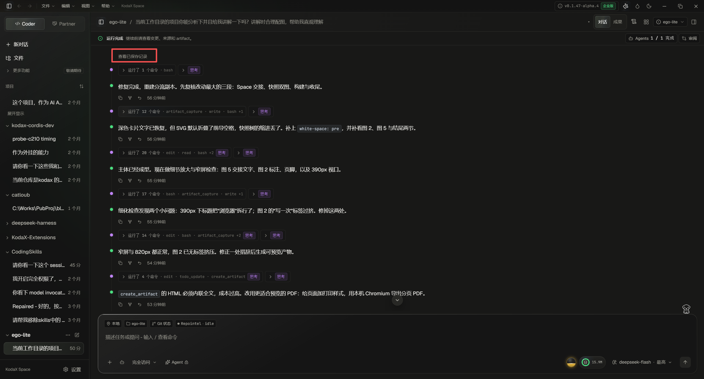

# 怎样让会话历史、实时输出与长内容浏览形成一致的阅读体验？

> 后续实施：本方案已在当前工作分支落地，执行验证见[实施验收](ui-interaction-fixes-validation-2026-11-09.md)。以下保留诊断与讨论当时的范围和证据。

2026-11-09。建议把产品目标定为“用户在同一段对话里自然向前、向后阅读，始终知道还有什么可读，并能回到刚才的位置”。先收敛实时与保存历史的接缝、导航和状态表达，再按实测推进渲染优化。红框按钮是这个接缝的可见症状，单独改字或加亮只能改善入口。

本文是用户截图、当前源码和第一方资料的方案研究；未现场操作该截图中的会话，也未进行竞品桌面实机测试。源码基线为 `ffeb9ed7`。建议均为待实施方案，不表示已经上线。

**同日交叉讨论修订：** 产品与工程 Agent 两轮讨论后，将首期收窄为顶部边界、真实状态、显式跳转落点与返回。保留 Ctrl+F 默认查找已加载内容，SDK 保存记录检索通过显式范围切换进入；搜索命中先定位上下文、失败降级原文作为第二片。跨 view/history 只在可信映射下连续切换。全局目录、整轮重组、未读计数与 F144 均不列为首期前置。详见[产品评审](session-history-product-cross-review-2026-11-09.md)和[工程评审](session-history-engineering-cross-review-2026-11-09.md)。以下表格与顺序已按此共识修订。

## 1. 红框按钮实际做什么

按钮文案为“查看已保存记录”，实现是一个 `text-xs text-fg-muted` 的原生 button。出现条件是已有实时 view、当前未选中保存历史、保存条目非空且分页处于 ready；条件没有证明“还有更早内容”，也没有证明两种来源的覆盖范围不同。[入口条件](../../apps/desktop/renderer/src/shell/ConversationStreamV2.tsx#L893) · [按钮](../../apps/desktop/renderer/src/shell/ConversationStreamV2.tsx#L2520)

点击按钮调用 `requestAdjacentHistory(..., 'older', true)`；第一步可以只把**已经缓存的最近历史页**选为正文，不发出更早页读取。它不表示展开所有记录，也不表示展开工具和思考。进入保存历史后，同修订相邻页已支持累计保留。[选择最近页](../../apps/desktop/renderer/src/shell/sessionHistoryPaging.ts#L1285) · [相邻页保留](../../apps/desktop/renderer/src/shell/sessionHistoryPaging.ts#L924)

向上滚动并非完全没有自动加载。现有滚轮、键盘、触摸和原生滚动条逻辑会尝试请求相邻历史；但从实时 view 切到保存历史时，需要所读项能唯一映射到保存项。无法取得该锚点且不是显式点击时，函数直接返回。显式按钮因此承担“允许跳到保存窗口”的兜底职责。[映射与提前返回](../../apps/desktop/renderer/src/shell/ConversationStreamV2.tsx#L1743) · [向上滚动](../../apps/desktop/renderer/src/shell/ConversationStreamV2.tsx#L1895) · [现有回归夹具中的显式入口](../../apps/desktop/renderer/src/shell/conversationHistoryNavigation.browser.test.ts#L293)

截图与实现共同支持三个体验问题：

1. **入口难辨认。** 小号弱化文字紧贴正文起点，容易被看作说明文字。截图可支持可发现性风险，但尚未测量实际主题下的颜色对比值和点击热区。
2. **操作结果不明确。** “已保存”是数据状态，用户真正想知道的是“前面还有没有对话、怎样继续看”。点击后可能发生来源切换和定位变化，却没有在入口解释落点。
3. **未解释的停顿削弱完整性信任。** 用户向上翻到边缘，无法可靠对齐时自动路径会停止；界面没有把“已到开头”“还有较早内容”“正在读取”“读取失败”“只能跳到历史位置”清楚分开。[请求条件](../../apps/desktop/renderer/src/shell/ConversationStreamV2.tsx#L1710) · [当前加载/错误状态](../../apps/desktop/renderer/src/shell/ConversationStreamV2.tsx#L3578)

## 2. 当前能力应作为改进基础

| 已有能力 | 源码证据 | 对方案的约束 |
| --- | --- | --- |
| 同修订保存页前后追加、按 ID 处理重复 | [sessionHistoryPaging.ts:924](../../apps/desktop/renderer/src/shell/sessionHistoryPaging.ts#L924) | 延续现有连续保存页，不重新退回逐页替换 |
| 实时 view 与保存历史分别存储、显式选择正文来源 | [productSessionView.ts:92](../../apps/desktop/renderer/src/store/productSessionView.ts#L92) | 统一用户阅读路径时仍要维护可信来源，避免凭正文相似合并 |
| 语义行锚点、相对偏移和接缝恢复 | [捕获](../../apps/desktop/renderer/src/shell/ConversationStreamV2.tsx#L1244) · [恢复](../../apps/desktop/renderer/src/shell/ConversationStreamV2.tsx#L1559) | 新方案须保留阅读位置，覆盖图片、工具和正文补齐引发的高度变化 |
| 搜索分为本页与保存会话，支持结果定位、回到搜索和原阅读位置 | [搜索范围](../../apps/desktop/renderer/src/i18n/messages.ts#L3814) · [搜索组件](../../apps/desktop/renderer/src/features/session/ProductHistorySearch.tsx#L112) | 改进默认意图与命中浏览，避免再次混用两种计数 |
| 长正文进入视口后补读、就地失败状态、全文读取校验 | [ProductItemBody.tsx:144](../../apps/desktop/renderer/src/features/session/messages/ProductItemBody.tsx#L144) · [完整性读取](../../apps/desktop/renderer/src/lib/productItemContent.ts#L42) | “复制全文成功”仍须以完整数据为准 |
| 主消息行全部映射挂载，用 content-visibility 降低屏幕外绘制成本 | [renderItems.map](../../apps/desktop/renderer/src/shell/ConversationStreamV2.tsx#L2621) · [styles.css:1353](../../apps/desktop/renderer/src/styles.css#L1353) | 这是浏览器遮挡优化，不等同于有界 DOM 虚拟化 |
| 默认折叠工具/思考，摘要模式过滤过程内容 | [展示模式](../../apps/desktop/renderer/src/shell/ConversationStreamV2.tsx#L969) · [折叠策略](../../apps/desktop/renderer/src/shell/ConversationStreamV2.tsx#L1155) | 展示密度、历史加载范围、模型上下文范围需分别表达 |
| 当前已显示提问的快速侧轨 | [提问收集](../../apps/desktop/renderer/src/shell/ConversationStreamV2.tsx#L1132) | 它还不能代表未加载历史中的全部提问 |

旧研究在 11 月 7 日提出的问题有部分已被当前版本处理，例如保存页累计保留、搜索范围区分和定位。因此本次依据当前代码判断现状，不把旧研究中的反例直接当作现行缺陷。[当前设计约定](../design/session-history-browsing-and-actions.md) · [旧研究](session-reading-ux-2026-11-07.md)

## 3. 外部与本地参照

完整一手来源与边界分别记录于：

- [主流桌面/IDE 产品对照](coding-agent-history-ux-competitors.md)：Cursor、Claude Code Desktop、VS Code Copilot、Windsurf/Cascade 的历史资料与现行边界。
- [deepseek-harness 源码研究](deepseek-harness-history-rendering-2026-11-09.md)：区分普通 Chat 与技术 Trajectory。
- [ZCode 源码研究](zcode-history-rendering-2026-11-09.md)：区分历史数据加载、整轮虚拟化和问题目录的预加载成本。

Codex/当前桌面官方文档也明确区分“搜索过去的聊天”和“在已打开聊天中查找”。其 App Server 支持最新轮优先分页、反向游标和项级分页；这是后端能力证据，不能据此断定桌面端具体如何触发向上加载。[桌面查找](https://learn.chatgpt.com/docs/reference/commands#search-past-chats-and-find-in-a-chat) · [轮次分页](https://learn.chatgpt.com/docs/app-server#list-thread-turns)

| 已核实的参照 | 对 KodaX 有用的借鉴 | 证据边界 |
| --- | --- | --- |
| Cursor 将跨会话检索和会话内 Ctrl+F 分开，支持命中间跳转 | 明确用户是在找会话还是找当前对话中的文字 | 未证实其向上分页、加载阈值与 DOM 策略。[官方文档](https://cursor.com/help/ai-features/conversation-search) |
| VS Code 可查屏幕外文字与代码块；命中 Completed N steps 时自动展开；支持上/下一提问和 sticky prompt | 查找应能把目标带到可阅读状态，长回答中应保留所属提问的方向感 | 不查 tool pills 和折叠 reasoning，不能称为任意细节的无边界全文搜索。[官方文档](https://code.visualstudio.com/docs/chat/chat-overview#find-text-in-a-chat-session) |
| Claude Code Desktop 的 Normal 模式折叠工具摘要但显示完整回答，另有 Thinking/Verbose | 将“过程展示密度”明确作为视图选项；回答仍是阅读主线 | 该文档不能证明压缩后所有历史原文的回看契约。[官方文档](https://code.claude.com/docs/en/desktop#switch-view-modes) |
| 历史 Cascade 1.6.1 在滚动时显示全部用户消息目录 | 提问摘录目录可辅助远距离定位 | 当前 Cascade 已 legacy；这是历史设计先例，不能宣称现行 Devin Local 相同。[历史发布说明](https://docs.devin.ai/desktop/changelog#v1-6-1) · [当前边界](https://docs.devin.ai/desktop/cascade) |
| deepseek-harness 的 Chat 手动补早页，保持内容锚点；durable 与 live attempt 有明确结算身份 | 优先借鉴数据衔接和用户阅读控制权；流式 Markdown 冻结稳定块也值得独立评估 | Chat 正文不是虚拟列表；Trajectory 才有自动上翻和表行虚拟化；普通 Chat 未证实完整会话全文查找。[源码研究](deepseek-harness-history-rendering-2026-11-09.md) |
| ZCode 尾窗打开、顶部预取，按整轮虚拟化，运行末轮独立常驻 | 稳定轮身份、前插锚点、静态/流式渲染分流可作为局部实现参照 | 宽屏提问目录会补齐全分支；整轮虚拟化仍可能挂载一个巨型轮；查找自动补页有阈值。[源码研究](zcode-history-rendering-2026-11-09.md) |

这些参照应分别回答三件事：用户怎样找到旧内容、客户端怎样读取数据、浏览器怎样控制渲染成本。一个产品在其中一项有优势，不能证明另外两项也适合直接照搬。

两个本地项目尤其说明：**分页、虚拟化和全文搜索是三个独立契约。** deepseek-harness Chat 的分页上限不能限制累计正文 DOM；ZCode 的虚拟化不能限制目录补齐全分支时的数据量。对 KodaX 应分别验收“是否可达”“加载多少”“挂载多少”“查找覆盖什么”，不能用一个“支持长会话”标签替代。[ChatFlow.tsx:52](C:/Works/PubProj/deepseek-harness/packages/client/ui-chat/src/client/chat/ChatFlow.tsx:52) · [ZCode 目录触发](C:/Works/PubProj/ZCode/packages/ui/src/v4/ConversationTimeline.tsx:768) · [ZCode 历史合入](C:/Works/PubProj/ZCode/packages/ui/src/v4/conversationProjectionStore.ts:1425)

## 4. 推荐的完整阅读路径

以下为设计建议，需用当前 SDK 和旧会话样本验证可实现性。

| 用户步骤 | 推荐的可见行为 | 验证重点 |
| --- | --- | --- |
| 1. 打开会话 | 首屏显示最新对话；从下方向上自然阅读。首屏恢复完成前不呈现“对话为空” | 打开时间、恢复状态、相同会话刷新前后顺序 |
| 2. 向上翻阅 | 靠近已加载内容上边界时，按需补入更早内容；现有段落停在原位置 | 滚轮、触控板、键盘、滚动条；短内容不足一屏 |
| 3. 跨越实时与保存历史接缝 | 能可信对齐就继续同一阅读路径。无法对齐时给明确可点击边界，说明“将定位到最近的历史消息”，保留返回位置 | 同文不同消息、无强身份旧会话、超长工具轮；不猜测合并 |
| 4. 看工具与思考 | 沿用现有正文与过程分层，按需要展开具体操作；运行中步骤和失败步骤可识别。更大范围的整轮重组另行评估 | 内容折叠不影响历史可达性、复制、搜索和操作目标 |
| 5. 查找旧讨论 | Ctrl+F 默认查找“已加载内容”；显式切换“搜索此对话”检索保存记录。保存命中优先定位前后文，无法定位时可读原文 | 搜索范围、实时未保存内容边界、命中数单位、折叠内容命中可见 |
| 6. 阅读期间收到输出 | 保持当前段落和焦点；底部统一提供带文字的“回到最新”，有可靠新增证据时提示“有新消息” | 不按 token 计消息；不把旧页后方已有内容误报为新增 |
| 7. 到达开头或遇到问题 | 根据真实状态显示“已到本会话开头”“正在加载更早消息”“较早消息加载失败，重试”或可读范围说明 | 数据不可用/部分恢复/源变化不能假装成会话开头 |

步骤 5 保留两种查找语义：SDK 搜索覆盖已保存记录，正在生成的内容可能尚未保存；当前已加载内容查找则能立即找到眼前文字。明确切换范围，不能把相关检索返回条数标作全文出现次数。相同查询词可保留，两种结果不静默合并。

普通发送仍作用于当前会话末尾；旧位置旁的分支/回退操作沿 SDK 解析出的完整轮次执行。浏览、提问定位和历史改写分别有自己的证据要求。[既有操作契约](../design/session-history-browsing-and-actions.md#二数据契约与归属)

## 5. 顶部入口怎样改

建议在正文上方使用与对话等宽的居中边界行，拥有清晰文字、适当留白、可见焦点和加载反馈。它表达阅读状态；不要把“展开所有历史”设为默认大操作。根据可证明的状态改变内容：

| 状态 | 推荐文案与动作 |
| --- | --- |
| 已知还有较早内容，可连续读取 | “更早的消息”＋“加载”；正常上翻自动触发，按钮供键盘操作和手动重试 |
| 正在读取 | “正在加载更早的消息…”；避免重复提交 |
| 确认已读到本分支起点且来源完整 | “已到本会话开头”；无加载动作 |
| 历史可读，但无法连续对齐 | “查看历史消息”；辅助说明“将定位到最近的历史消息”，进入后可“返回原处” |
| 读取失败 | “较早消息加载失败”＋“重试”；已有内容保持可读 |
| 部分历史不可取得 | 显示实际可读范围与原因；保留可用查找与原文入口 |

现在 `canOpenSavedPage` 只证明历史非空，因此不能直接把现有文案一律替换成“还有 N 条消息”或“加载全部”。要先由 SDK/已有来源证据判断是否存在额外范围；无法证明时采用上述可读历史兜底态。[当前条件](../../apps/desktop/renderer/src/shell/ConversationStreamV2.tsx#L894)

点击热区、前景文字和焦点样式沿项目现有按钮体系落实。截图仅提示弱对比和小目标风险；实施时要在深浅主题、键盘焦点与放大显示下实际检查。

## 6. 渲染和数据侧怎样收敛

**统一阅读意图。** UI 围绕“最新 / 正在读某个位置 / 搜索命中”组织操作。分页来源、正文预览和缓存状态属于内部事实，只有影响用户下一步时才说明。底部控制区统一表达“回到最新”；“返回原处”和“返回搜索结果”保留各自明确的落点。

当前 `hasNewer` 也被用于表达“已选择保存历史”，例如初次切入缓存页时直接设为 true；它不能直接充当“阅读期间收到新消息”的证据。新增提示应依据另行验证的消息/提交身份。[当前赋值](../../apps/desktop/renderer/src/shell/sessionHistoryPaging.ts#L1305)

**沿可信位置连接数据。** 继续使用 SDK item/来源版本/游标来扩展同一修订的保存历史。实时内容与保存项的对应由已验证身份完成；没有对应关系时，展示有说明的跳转兜底。历史有效性变化、正在运行的未保存尾部和用户已读窗口分别处理。实现前先统计当前旧会话能自动对齐的覆盖率，判断是否确实需要补 SDK 契约。[现有身份映射](../../apps/desktop/renderer/src/shell/ConversationStreamV2.tsx#L1743) · [保存窗口修订校验](../../apps/desktop/renderer/src/shell/sessionHistoryPaging.ts#L1297)

**保留正文主线，再评估整轮组织。** 用户提问和回答沿当前顺序可读，过程记录保留可展开入口和失败、权限请求、运行中状态。首期不为减少过程噪音而把目前独立呈现的中间回答重新折叠。整轮导航或重组作为独立候选；其布局分组不能充当可安全回退的持久边界。[轮次操作约定](../design/session-history-browsing-and-actions.md#4-fork) · [产品评审](session-history-product-cross-review-2026-11-09.md)

**分开优化四种成本。** 分页减少初次读取；正文按需读取减少字节和解析；虚拟化减少挂载 DOM；流式节流/稳定块缓存减少频繁重算。它们需要各自的指标。当前 Markdown 有按内容与语言的 500 项缓存，思考文本的 JS 字符串长度超过 `64 * 1024` 后按 `8 * 1024` 个 UTF-16 代码单元分段显示，正文也有有界读取校验；这些已有手段应先纳入基线。[Markdown 缓存](../../apps/desktop/renderer/src/features/session/messages/Markdown.tsx#L73) · [思考分段](../../apps/desktop/renderer/src/features/session/messages/ThinkingText.tsx#L5) · [正文读取](../../apps/desktop/renderer/src/lib/productItemContent.ts#L42)

## 7. 可交付的顺序

1. **阅读路径与入口状态。** 建立真实失败样本，补齐顶部边界状态，改进兜底入口与落点说明，保留自动向上读取和原位置恢复；以“所有可读保存项可到达”验收。
2. **保存检索结果直达。** 保留 Ctrl+F 默认查找已加载内容；切换保存检索后，命中优先通过现有 around 能力进入上下文，不能定位则保留原文与返回路径。计数、键盘焦点和来源失效一起验收。
3. **按测量推进导航与性能候选。** 全局提问目录、整轮重组、可靠新消息提示各自按任务收益评估。对 1k/10k/30k 混合内容与单个巨型轮分别测量；DOM 成为主要瓶颈时推进 F144，先把当前 DOM 查找迁到逻辑项寻址，并保住选择复制、焦点和滚动体验；IPC/正文解析耗时则先处理对应成本。[F144 当前范围与目标](../features/v0.2.x-plus.md#feature_144-windowed-continuous-transcript-virtualization) · [工程评审](session-history-engineering-cross-review-2026-11-09.md)

每一步都要从用户入口验收，避免只证明某个函数能返回正确页。没有性能测量之前，不将新增虚拟化组件设为阅读接缝修复的前置依赖。

## 8. 验收场景与指标

| 任务 | 必须可观察到的结果 |
| --- | --- |
| 一页历史与实时窗口覆盖不同 | 所有可读项均能到达；无游标也可进入最近保存页；不凭缓存存在就声称还有更早消息 |
| 200 条与跨页巨型工具轮 | 按身份逐项核对可达、顺序、重复；单轮跨页不丢提问或尾部 |
| 向上加载与长正文/图片完成 | 原段落与焦点稳定；记录锚点像素漂移、加载延迟和主线程长任务 |
| 阅读旧内容时生成新输出 | 不抢位置；明确到最新的动作；新增提示依据可靠的提交/消息身份 |
| 关键词只在折叠步骤或未加载页 | 会话搜索可找，定位后目标可见；搜索返回与退出分别恢复正确位置 |
| 鼠标、键盘、触摸和滚动条 | 都能访问旧内容；程序滚动不误触发分页；不足一屏的边界也可继续 |
| 换会话、断线、历史源变化 | 迟到返回不串页；可读旧内容保留；过期结果可重新查找 |
| 复制长回答、思考或工具原文 | 全文与预览明确区分，完整读取失败不会提示成功 |
| 万级消息与一个极大轮 | 分别记录首屏可读时间、IPC 字节、峰值内存、DOM/布局、输入与滚动响应 |

现有 F144 文档的万行挂载不超过 500 行、布局稳定后锚点偏移不超过 2 px 是设计目标，不能写成当前实测结论。[原始目标](../features/v0.2.x-plus.md#L55)

## 9. 未证实与未解问题

- 未操作截图中的具体会话，尚不能判断该会话遗漏的是保存页、被折叠工具、预览截断还是实际不可恢复记录；本次确认的是入口和分支代码的语义。
- 未实机走完竞品的长会话分页流程。竞品官方资料未说明的加载触发、页大小和内存策略，不作为其产品能力结论。
- 当前实际旧会话中，实时/历史自动对齐失败的比例、无法恢复项的类型与规模，仍需只读样本核对。
- 搜索“整个会话”如何覆盖正在生成的内容、压缩归档与当前分支，需按 SDK 现有检索范围定义；不能许诺未提供的全量出现次数。
- 问题目录是否显著提升找回效率、整轮虚拟化能否处理单个巨型轮、常见数据的主要性能开销，均待基准和任务测试决定。
- 本次只增加调研材料，未修改业务代码，未重新运行应用或自动化测试。已有测试只作为当前设计意图与覆盖样例阅读，不据此宣称当前环境已通过。
