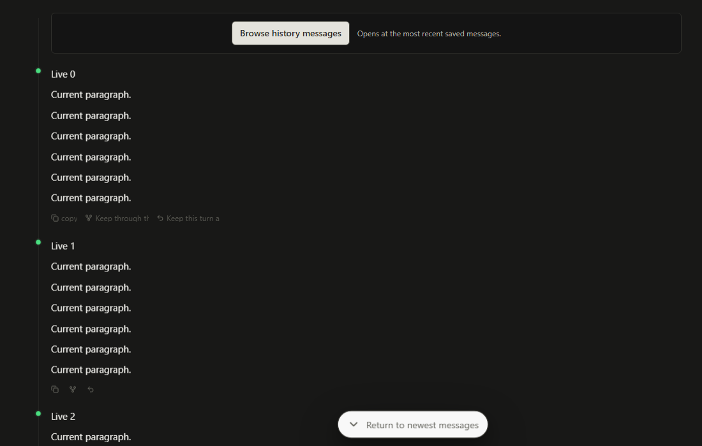
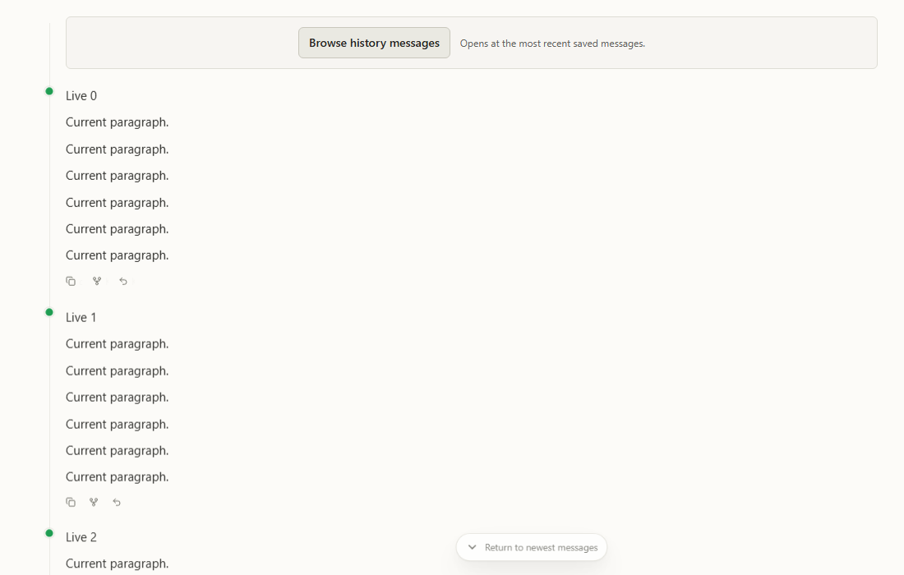
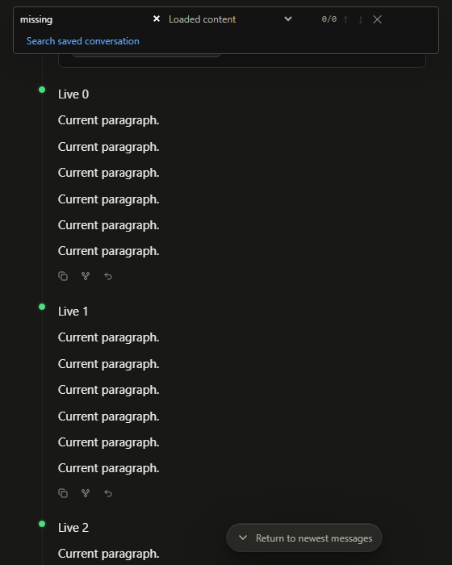

# 交互修复实施与验收记录

2026-11-09，基线 `ffeb9ed7`，当前工作分支 `KodaX-Space-next-dev`。修复范围为 Issues 239–241：Artifact 单击打开、slash 补全结束与提交、历史边界及保存检索直达。版本维持 Space 0.1.47-alpha.4 / Registry SDK 0.7.97-beta.4；没有发布、推送或变更 SDK 契约。

## 实际变更

- Shell 在侧栏未挂载时持有会话/项目范围内的 Artifact 打开目标；侧栏消费后清除。缓存 File Viewer 先恢复，本次显式目标后应用，避免旧文件覆盖新成果。
- Slash 动态参数按实际位置结束；help 可选主题由用户主动前缀触发，末级不重复追加。ready 零匹配 Enter 交给普通提交；发现仍在加载或失败时维持旧有保护。
- 历史顶部提供可点击边界与落点说明，保留单页入口、相邻页连续阅读、失败重试和返回原处。只在来源完整且无较早页时声称已到开头。
- Ctrl+F 仍默认查已加载内容；显式保存检索的命中优先定位上下文，无法定位可读原文，过期可重查。底部最新动作有可见文字；窄窗口搜索控件可换行。
- 用户手册、应用内手册、当前设计与 Unreleased changelog 同步。F144、全局目录、未读计数与工具整轮重组按原规划独立评估。

## RED → GREEN 与评审

| 公共边界                       | 实际执行的失败与修复验证                                                                                               |
| ------------------------------ | ---------------------------------------------------------------------------------------------------------------------- |
| 真正的 Shell / 卡片 / 条件侧栏 | 首次只展开的断言在旧源码 overlay 上 RED；新实现 GREEN。包括选择非默认成果、关闭重挂载、延迟列表、项目/会话 A→B→A       |
| File Viewer 与 Artifact 的组合 | Spec 评审用旧文件→关闭→成果发现 P1；新增永久回归在暂存旧实现 RED，恢复优先级调整后 GREEN，同时验证随后真正的新文件请求 |
| 真正的 Composer / Popover      | help 的 Tab 结束、ready 无匹配提交、嵌套末级结束先 RED 后 GREEN；加载/失败的 Enter 保护也先 RED 后 GREEN               |
| 真正的 ConversationStreamV2    | 可解释的单页历史入口与返回断言先 RED 后 GREEN；补充部分来源、不误报起点、读取失败及重试                                |
| 真正的 ProductHistorySearch    | 单击命中须调用定位且不读取完整原文先 RED 后 GREEN；覆盖 missing/failed/stale、原文退路、查询/会话取消和迟到结果        |

两名新上下文 Agent 独立运行 Standards / Spec 双轴评审。Standards 0；Spec 首轮 1 项 P1，修复后复核 0 项未解决。完整报告见[双轴评审](ui-interaction-fixes-review-2026-11-09.md)。

## 执行结果

| 检查                                           | 结果与边界                                                                                                                                                                                                                                 |
| ---------------------------------------------- | ------------------------------------------------------------------------------------------------------------------------------------------------------------------------------------------------------------------------------------------ |
| `npm ci --ignore-scripts --no-audit --no-fund` | 当前 worktree 独立安装依赖；随后按仓库脚本准备 native，未复用主检出源码或修改其依赖                                                                                                                                                        |
| `npm run typecheck`                            | 通过，包括 renderer、Electron 和共享包                                                                                                                                                                                                     |
| `npm run lint`                                 | 全仓通过，零警告                                                                                                                                                                                                                           |
| `npm test`                                     | 通过：release 160 项（153 passed / 7 skipped），desktop 4,270 项（4,257 passed / 13 skipped），IPC schema 373 项全通过；合计 4,803 项，4,783 passed / 20 conditional skips / 0 failures                                                    |
| 历史导航＋保存检索定向 UI                      | 23/23 通过；包括既有原生滚动条按住、短视口、慢渲染、前插锚点与迟到请求回归                                                                                                                                                                 |
| 最终 Artifact＋Composer＋邻源参数定向 UI/单测  | 14/14 通过；补全与已有 slash/skill 组合另外通过；无条件跳过                                                                                                                                                                                |
| `slashInput.ts` Node coverage                  | 行覆盖率 96.68%，函数 100%，分支 77.88%。这是该入口的 Node 覆盖率，不是整个 renderer 的覆盖率；UI 使用真实组件交互断言                                                                                                                     |
| `npm run build:smoke`                          | 通过。最终 renderer 在评审修复及响应式调整后再构建通过；现有 Vite 大 chunk 提示仍在，本次未调整分包策略                                                                                                                                    |
| 隔离 Electron 相关 E2E                         | 19 个相关场景已分别通过：首轮 17 passed，2 个旧 Workflow 断言失败；核对基线后仅适配旧断言，重跑该 2 项通过。覆盖真实 SDK 历史导航、搜索/原文/返回、Composer、命令回执、文件/PDF/HTML及独立成果窗口                                         |
| 打包与成品检查                                 | 通过 `node scripts/pack.mjs --win`：Setup / Portable 均生成且小于 250 MB，exact Registry/asar/native/Artifact worker 检查全过；成品启动通过，122 条历史子记录保留；打包流程追加的 7 项真实 SDK、重载/Fork/Rewind、队列及完整退出场景全通过 |

完整 `npm test` 输出保存在本机临时日志 `kodax-space-ui-fixes-full-test.log`，新增回归文件随源码保留。测试均使用模拟或隔离 profile，没有用用户实际会话或 Provider 凭据。后续针对新修改的复查单独记录，不将重复运行计入上面的全套统计。

E2E 首轮失败的两个 Workflow 用例仍把命令回执查作 user-message-bubble，并匹配小写 generating。`git show ffeb9ed7` 已使用 appendLocalNotice 和 `Generating workflow...`，相关产品路径本次 diff 为空；失败页面也确有命令回执和进度。只将断言改为 local-notice-bubble 与大小写兼容的精确进度表达，两入口仍要求 2 秒内回显、进度可见且不生成伪用户进度气泡。Spec 复核无新增 finding；未为测试恢复旧产品行为。日志为 `kodax-space-ui-fixes-e2e.log` 和 `kodax-space-ui-fixes-workflow-e2e.log`。

原始诊断入口在当前实现上复跑也已 GREEN：折叠侧栏首次点击即选中并读取目标，help Tab 后列表数量为 0。Artifact 前后对照见[修复后记录](artifact-open-fixed-evidence-2026-11-09.json)及此前保存的失败记录。

## 视觉验证

以下为当前真实 ConversationStreamV2、模拟消息和生产 CSS 的隔离 Chromium 截图，已逐张打开检查。它们证明本次边界与搜索控件的实际布局，不是完整桌面应用或用户原会话截图。

窄视口检查发现零匹配提示会挤出搜索输入，随后用最大宽度和换行修复；最终检查无水平溢出、无 pageerror。截图使用虚构消息，不含真实用户内容。

## 平台与发布边界

- 本机为 Windows；macOS/Linux 的成品与输入法人工验收没有在本机冒充完成。
- 未改 SDK 输出来源、消息身份或保存格式；未做真实用户历史迁移、删除、回退或重写。
- 见[回归指南](../test-guides/ISSUE_239_0.1.47-alpha.4_REGRESSION_GUIDE.md)中的人工用例。版本未提升，发布仍是后续单独操作。
